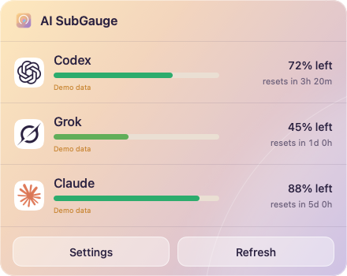
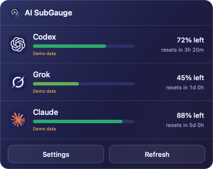
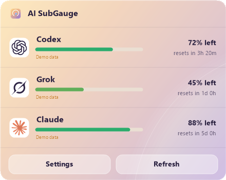
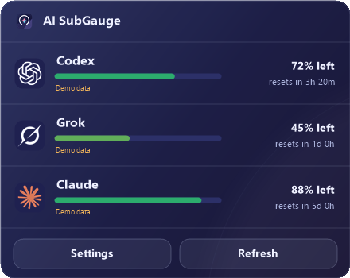

<div align="center">


# AI SubGauge

See how much of your AI subscriptions is left, from the macOS menu bar or the Windows tray.

[](mac/README.en.md)
[](windows/README.md)
[](LICENSE)
[](#installation)
[](https://github.com/MK420-max/ai-subgauge/stargazers)

**English** · [简体中文](README.zh-CN.md)

</div>

Mac 2.0 adds quota-arc menu bar icons, glass panels, a unified settings window, and menu bar collection. Windows keeps its existing tray interface.

## Screenshots

Rendered with each app's offline preview mode (demo data: Codex 72%, Grok 45%, Claude 88%).

| | Light | Dark |
|---|---|---|
| **macOS** |  |  |
| **Windows** |  |  |

### What the icons mean


macOS 2.0 menu bar: each subscription has a service icon and remaining-quota arc. Percentages are optional and can appear above the arc or beside the icon. Open the glass panel for quota details, reset times and refresh errors. The screenshots above show the earlier interface.


Windows tray (demo data): one icon per provider. The coloured fill is the remaining quota in 10% steps: green at 50% and above, shading through yellow to red at 15% and below. An all-grey icon means unknown or refresh failed. Hover for the exact percentage and error; click for the details panel.


English and Simplified Chinese panels (demo data). The bottom row shows a Windows panel with a refresh error.

## Features

- 🍎 **macOS:** remaining quota for Codex, Claude and Grok Bot subscriptions in the menu bar, with reset times. Optional API accounts show balances or usage where the provider offers it.
- 🧹 **macOS:** organize menu bar icons into visible, collected and always-hidden zones; search, reorder, group and back up positions.
- 🪟 **Windows:** remaining quota only, one liquid-level tray icon per provider, plus a details panel.
- 👀 Shows only the AI apps and CLIs that are running (30-second grace period), or all selected providers if you prefer.
- 🔒 Uses logins already on your computer. Local login reuse is off by default and is enabled per provider.
- 🌐 English and Simplified Chinese; light and dark themes that follow the system.

### Supported providers

| Provider | macOS | Windows |
|---|:---:|:---:|
| Codex (ChatGPT subscription) | ✅ | ✅ |
| Claude | ✅ | ✅ |
| Grok Bot | ✅ | ✅ |
| Gemini | API key | ✅ |
| GitHub Copilot | — | ✅ |
| Kimi | API key | ✅ (Kimi Code) |
| GLM / z.ai | — | ✅ |
| OpenAI API, Anthropic API, xAI API | API key | — |
| DeepSeek API, OpenRouter API, MiniMax API | API key | — |

What each API key can show depends on the provider. See [mac/AI_SUPPORT.md](mac/AI_SUPPORT.md) and the [Windows quota sources](windows/README.md#local-logins-and-quota-sources).

## Installation

The app can be installed on macOS 26, but it has not yet been tested on a physical Mac running macOS 26; menu bar icon detection may differ.

There are no prebuilt releases yet. Build from source (below), then:

- **macOS 26 or later (Apple Silicon):** move `dist/AI SubGauge.app` to `/Applications`. Builds are ad hoc signed, not notarized, so Gatekeeper may ask you to approve the app. Icon organization needs Accessibility permission.
- **Windows:** copy the published files to `%LOCALAPPDATA%\Programs\AISubGauge\` and run `AISubGauge.exe`. No administrator rights are needed.

Upgrading from Mac AI Bar Cleaner or WindowsQuotaTray: settings are migrated on first launch. See [mac/docs/MIGRATION.md](mac/docs/MIGRATION.md) and [windows/README.md](windows/README.md#migration-from-windowsquotatray).

## Usage

1. Sign in to the official app or CLI you already use (Codex, Claude Code, Grok CLI, and so on).
2. Allow AI SubGauge to reuse that login: on macOS in **Settings → General**; on Windows, answer the prompt for each detected provider or use **Local login consent** in the tray menu. Each provider has its own switch.
3. Read the percentage in the menu bar or tray. Quota refreshes every five minutes, or use **Refresh**.
4. Choose which providers to show, and whether to show them only while they are running.

macOS shortcuts: `⇧⌘B` toggles the collection bar, `⇧⌘Space` searches icons.

## Build from source

macOS (from `mac/`):

```sh
swift test --sdk "$(xcrun --show-sdk-path)" --triple arm64-apple-macosx26.0
zsh build.sh          # dist/AI SubGauge.app and .zip
```

Windows (from `windows/`, .NET 8 SDK):

```powershell
dotnet restore .\AISubGauge.sln --locked-mode
dotnet test .\tests\AISubGauge.Tests\AISubGauge.Tests.csproj -c Release
dotnet publish .\src\AISubGauge\AISubGauge.csproj -c Release -r win-x64 --self-contained true -p:PublishSingleFile=true -o .\publish\win-x64
```

Keep `mac/`, `windows/` and `shared/` side by side. Full details: [mac/README.en.md](mac/README.en.md), [windows/README.md](windows/README.md).

## Privacy & Security

- Tokens stay on your computer. The app reads existing local login files read-only and sends them only to each provider's official endpoint. It does not log tokens.
- Two exceptions to read-only: the official Grok CLI renewal rewrites its own `auth.json`, after which the app tightens that file's permissions. On macOS, API keys you add are stored in the Keychain.
- Running-app detection reads process names only, never command lines, paths or process memory.
- No model prompts are sent. No browser cookies are read.
- Credential files that other users can read are refused. CLIs are run only after their official code signature is verified.
- Diagnostics export shows a redacted preview first.

Details: [macOS SECURITY.md](mac/docs/SECURITY.md), [Windows SECURITY.md](windows/docs/SECURITY.md), [macOS PRIVACY.md](mac/PRIVACY.md).

## FAQ

**The menu bar shows `—` or `⚠︎`.** There is no current value, or the last refresh failed. Open the menu to see the reason, for example an expired login that needs you to sign in again in the official app.

**A provider doesn't appear.** By default only running AI apps and CLIs are shown. Turn on "Always show all selected providers", and check that login reuse is allowed for that provider.

**Windows shows "Demo data".** The real read failed; the cause is shown in the panel and tooltip.

**Does it use my quota?** No. It only reads usage endpoints and never sends prompts.

## Contributing

Issues and pull requests are welcome. Please run the macOS and Windows tests above before opening a PR, and keep UI text in both `shared/i18n/en.json` and `shared/i18n/zh-Hans.json`.

## License

[MIT](LICENSE). Provider names and logos belong to their owners; see [mac/THIRD_PARTY_NOTICES.md](mac/THIRD_PARTY_NOTICES.md) and the Windows README.

## Star History

If AI SubGauge is useful to you, a ⭐ helps others find it. Thank you!

[](https://star-history.com/#MK420-max/ai-subgauge&Date)
