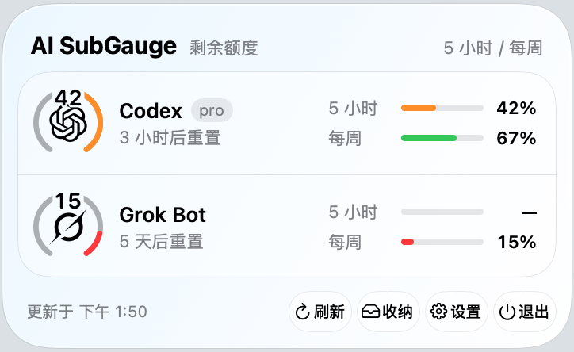

<div align="center">

[English](README.md) · **简体中文**


# AI SubGauge

在 macOS 菜单栏或 Windows 托盘，一眼掌握 AI 订阅的剩余额度。

[](#macos)
[](#windows)
[](LICENSE)
[](#macos)
[](#windows)
[](https://github.com/MK420-max/ai-subgauge/stargazers)

[功能](#功能) · [安装](#安装) · [隐私](#隐私与安全) · [从源码构建](#从源码构建)

</div>

随时查看剩余额度、重置时间和刷新错误，省去逐个打开服务商后台的步骤。macOS 版还可在同一应用中整理菜单栏图标。

<p align="center">
  
</p>
<p align="center">
  
</p>

## 功能

### macOS 版

- **额度一眼可见。** Codex、Claude、Grok Bot 订阅各有独立菜单栏图标和剩余额度圆弧。百分比可隐藏，也可显示在圆弧上方或图标旁。
- **详情随时展开。** 玻璃面板显示剩余额度、重置时间和刷新错误；统一设置窗口集中管理订阅与菜单栏收纳。
- **菜单栏更整洁。** 将图标分为显示、收纳、始终隐藏三个区域，支持搜索、排序、分组和位置备份。
- **可选 API 账户。** 单独连接受支持的 API 服务，在官方接口提供数据时查看余额或用量。

### Windows 2.0 版

- **每家一个额度圆环。** 在托盘显示 Codex、Claude、Grok Bot。优先显示五小时余量，缺少该窗口时显示每周余量。默认隐藏百分比，可在 **设置 → AI 订阅** 中开启。
- **额度窗口分别显示。** 面板提供五小时和每周两条额度条。缺失的额度、重置时间和套餐会明确标注为未提供；Grok 通常只有每周额度。
- **读取失败仍可参考。** `last-good.json` 仅缓存最近成功读取的百分比和时间，不存凭据。刷新失败后继续显示这些数值，并标注已过期、更新时间及错误原因。
- **Grok 自动续期。** 令牌到期前 30 分钟开始在后台调用本机官方 CLI，临时失败后自动重试；需要重新登录时可打开官方 CLI 登录流程。
- **原生桌面操作。** 单击托盘图标看详情，右键刷新、打开设置或退出。支持高 DPI，窗口和托盘可分别跟随系统主题。

### 两个平台共有

- 默认每五分钟刷新一次，也可手动刷新。
- 默认只显示正在运行的所选 AI 应用或 CLI，退出后保留约 30 秒；开启 **始终显示** 可持续显示。
- 复用本机已有登录，默认关闭，需按服务商分别授权。
- 支持简体中文和英文、浅色和深色主题，以及登录时启动设置。

### 服务商与额度来源

| 服务商 | macOS | Windows 2.0 |
|---|---|---|
| Codex | ChatGPT 订阅 | 官方 Codex CLI 的 `app-server` JSON-RPC，需使用 ChatGPT 订阅登录 |
| Claude | Claude Code 的 OAuth 登录 | Claude Code 的 OAuth 登录，读取官方用量接口 |
| Grok Bot | 官方 Grok CLI 登录 | 官方 Grok CLI 登录，读取官方账单接口 |
| Gemini、Kimi | API 密钥 | — |
| OpenAI API、Anthropic API、xAI API | API 密钥 | — |
| DeepSeek API、OpenRouter API、MiniMax API | API 密钥 | — |

API 可提供的数据取决于服务商和套餐，详见 [macOS 服务商说明](mac/AI_SUPPORT.md)和 [Windows 2.0 额度来源](windows/README.md#凭据与额度来源)。本文介绍的 Windows 2.0 安装包聚焦 Codex、Claude、Grok Bot。

## 安装

### macOS

**Mac 2.0.3 · 构建 204 · Apple 芯片**

> 部署目标支持 **macOS 26.0 及以上**。应用**尚未在运行 macOS 26 的真实硬件上测试**，该系统上的菜单栏图标识别和收纳仍需实机验证。

1. 按[构建说明](#构建-macos-版)从源码生成应用。
2. 将 `mac/dist/AI SubGauge.app` 移到 `/Applications`。
3. 打开应用。构建使用临时签名，未经过 Developer ID 签名或公证，Gatekeeper 可能要求手动允许。
4. 使用菜单栏图标整理时，授予 **辅助功能** 权限。其他权限仅在使用相关可选功能时请求。

菜单栏桥接使用 macOS 私有接口，系统更新后可能需要适配。需要开机启动时，可开启 **设置 → 通用 → 登录时启动**。

从 Mac AI Bar Cleaner / mac-menu-bar-tidy 升级时，请先退出旧应用。首次正常启动会将偏好和本应用的 API 钥匙串条目复制到新标识下，保留旧数据，并优先使用已有的新设置。详见[迁移说明](mac/docs/MIGRATION.md)。

### Windows

**Windows 2.0.0 · x64**

> **Windows 10 / 11 兼容性属于推断**，依据是项目的 `net8.0-windows` 目标和 `win-x64` 运行时。应用**尚未逐一验证所有 Windows 版本**。自包含安装包无需另装 .NET。

Windows 2.0 提供两种安装方式：

- **安装包：** 运行 `AISubGauge2-Setup-2.0.0.exe`，添加 `/Q` 可静默安装。
- **便携包：** 解压 `AISubGauge2-2.0.0-win-x64.zip`，在解压目录中运行：

  ```powershell
  powershell.exe -NoProfile -ExecutionPolicy Bypass -File .\install.ps1
  ```

安装无需管理员权限，会创建开始菜单快捷方式，并通过当前用户的 `Run` 注册表项默认开启自启动。可在 **设置 → 通用** 中关闭。

| 项目 | 位置 |
|---|---|
| 程序 | `%LOCALAPPDATA%\Programs\AISubGauge2\AISubGauge2.exe` |
| 设置 | `%LOCALAPPDATA%\AISubGauge2\settings.json` |
| 日志 | `%LOCALAPPDATA%\AISubGauge2\logs\app.log` |

2.0 可与 1.x 同时安装。卸载可使用开始菜单快捷方式，或运行安装目录中的 `uninstall.ps1`；添加 `-KeepSettings` 可保留设置。详见 [Windows 安装与并行使用说明](windows/README.md#与-1x-并行)。

## 开始使用

1. **先在官方应用或 CLI 登录。** Codex 需要 ChatGPT 订阅登录，API 密钥账户不适用；Claude 使用 Claude Code 的 OAuth 登录；Grok 使用官方 Grok CLI 登录。
2. **逐家允许复用本机登录。** macOS 在 **设置 → 通用** 中开启；Windows 可在服务商授权提示中允许，或使用托盘菜单中的 **本机登录授权**。
3. **选择显示范围。** 勾选服务商，按需开启 **始终显示**。Windows 2.0 每两秒检测运行状态，macOS 每五秒检测一次。
4. **打开面板查看详情。** 查看重置时间、手动刷新，或按登录错误提示重新完成官方登录。Windows 面板可单击外部区域或按 Esc 关闭。

macOS 快捷键：`⇧⌘B` 展开或收起收纳栏，`⇧⌘Space` 搜索图标。

Windows 2.0 从 `CLAUDE_CODE_OAUTH_TOKEN` 或 `%USERPROFILE%\.claude\.credentials.json` 读取 Claude 的 OAuth 登录，并使用 `%USERPROFILE%\.grok\bin\grok.exe` 中已登录的 Grok CLI。启动 Codex、Grok CLI 前会检查签名。未签名的 npm 版 Codex 默认拒绝，可在 Windows 设置中手动允许；MSIX / Store 版 Codex 不会自动发现，可用 `CODEX_EXE` 指定路径，仍需通过签名校验。

## 截图与图标说明

以下早期界面截图由离线预览模式生成，使用演示数据：Codex 72%、Grok 45%、Claude 88%。它们用于展示主题和布局，不能作为真实账户读数或 Windows 2.0 界面的验证依据。

| | 浅色 | 深色 |
|---|---|---|
| **macOS** |  |  |
| **Windows** |  |  |


macOS 菜单栏显示服务商图标和剩余额度圆弧；百分比可选，面板中可查看重置时间和错误详情。


图中的早期 Windows 液位图标以 10% 为一格：50% 及以上为绿色，逐渐经黄色过渡至 15% 及以下的红色。全灰表示未知或读取失败，悬停可看精确数值和错误，单击查看详情。Windows 2.0 使用额度圆环。


早期双语界面预览，使用演示数据；下排包含 Windows 刷新错误示例。

## 隐私与安全

- **本机登录访问。** 订阅读取仅在授权后使用本机已有的官方 CLI / OAuth 登录信息，不读取浏览器 Cookie 或聊天记录。macOS 可选 API 账户使用你主动添加并保存在系统钥匙串中的密钥。
- **凭据留在本机。** 凭据仅会随请求发往对应服务商的官方 API，除此之外不会离开本机；没有凭据上传服务，也没有遥测。
- **日志不含敏感内容。** 不记录令牌、Cookie 或响应正文。Windows 2.0 日志仅含时间、服务商、阶段、故障类型和 HTTP 状态码，不含异常原文或路径。导出诊断前会先显示脱敏预览。
- **不发送提示词。** 额度检查只读取用量接口，不提交模型提示词，不消耗模型推理额度。
- **限制进程检测范围。** 显示状态检测仅读取进程名，不读取命令行、可执行文件路径或进程内存。
- **受控续期。** 读取登录信息时不改写凭据；Grok 官方 CLI 续期时可更新自身登录文件，随后应用会收紧文件权限。不安全的凭据文件会被拒绝，官方 CLI 执行受平台签名检查约束；Windows 的 npm 手动允许选项见上文。

macOS 可选天气功能会向 Open-Meteo 发送所配置城市的坐标。详见 [macOS 隐私说明](mac/PRIVACY.md)、[macOS 安全说明](mac/docs/SECURITY.md)和 [Windows 凭据与安全说明](windows/README.md#凭据与额度来源)。

## 从源码构建

请保持 `mac/`、`windows/`、`shared/` 位于同一级目录。

### 构建 macOS 版

使用 Apple 芯片设备，安装 Xcode 命令行工具和适用的 macOS SDK。项目使用 Swift tools 5.9、Swift 5 语言模式及 Swift Testing。从仓库根目录执行：

```sh
cd mac
swift test --sdk "$(xcrun --show-sdk-path)" --triple arm64-apple-macosx26.0
zsh build.sh
# 可选：生成磁盘映像。
zsh package-dmg.sh
```

产物位于 `mac/dist/`，包括 `AI SubGauge.app`、`AI SubGauge.zip`，以及按需生成、带版本号的 arm64 DMG。打包不会安装或启动应用。详见 [macOS 构建说明](mac/README.md#构建测试与打包)。

### 构建 Windows 版

使用 Windows、PowerShell 及包含 Windows Desktop 支持的 .NET 8 SDK。`windows/` 目录包含 Windows 2.0 源码，包括 `build.ps1`、`install.ps1`、`uninstall.ps1`、`src/` 和 `tests/`。从仓库根目录执行：

```powershell
cd windows
powershell.exe -NoProfile -ExecutionPolicy Bypass -File .\build.ps1
```

脚本会构建、测试并打包 Windows 2.0。产物位于 `windows/` 内的 `artifacts\`，包括自包含程序 `publish\AISubGauge2.exe`、便携 ZIP，以及 IExpress 可用时生成的安装包。详见 [Windows 构建与测试说明](windows/README.md#构建与测试)。

## 项目结构

```text
mac/       Swift、SwiftUI 和 AppKit 菜单栏应用
windows/   C# / .NET WinForms 托盘应用与测试
shared/    品牌素材、服务商图标、主题和翻译
docs/      截图与技术说明
```

## 常见问题

**为什么某家服务商消失了？** 默认只显示正在运行的应用和 CLI。可开启 **始终显示**，同时检查服务商勾选状态和本机登录授权。

**`—` 和 `⚠︎` 表示什么？** 当前数值不可用或刷新失败，打开面板可查看原因。缺失的五小时数据会保持未提供状态，每周额度显示在自己的窗口中。

**Windows 刷新失败后会怎样？** 2.0 会保留最近成功读取的数据，标注已过期和更新时间；早期 1.x 构建在读取失败时可能显示明确标注的演示数据。

**Grok 什么时候需要重新登录？** Windows 2.0 在鉴权失败、连续六次续期失败，或令牌已过期且续期失败时提供重新登录入口。点击后会运行 `grok.exe login`。签名失败需要重新安装官方 CLI；验证仅使用本地证书吊销缓存，缓存不足时可能无法通过。如果签名校验未响应，请重启 AI SubGauge。

**Windows 托盘图标在哪里？** 托盘溢出区的位置由 Windows 决定，可按需在系统设置中将图标移出溢出区。

## 参与贡献

欢迎提交问题和拉取请求。请附上应用版本、系统版本及复现步骤，并将截图和诊断中的私人信息脱敏。提交前请运行上方对应平台的测试；界面文案请同步更新 `shared/i18n/en.json` 和 `shared/i18n/zh-Hans.json`。

## 许可证

[MIT](LICENSE) · 版权所有 © 2026 Mike Kou。

服务商名称和图标归各自所有者所有，详见 [macOS 第三方声明](mac/THIRD_PARTY_NOTICES.md)和 [Windows 说明](windows/README.md#许可证)。

[](https://star-history.com/#MK420-max/ai-subgauge&Date)

如果 AI SubGauge 让你用得更顺手，欢迎[给项目点一颗星](https://github.com/MK420-max/ai-subgauge) ⭐，帮助更多人发现它。谢谢！
