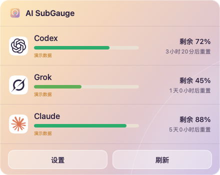
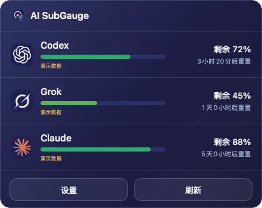
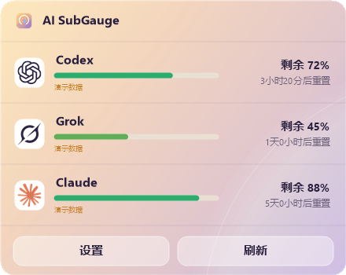
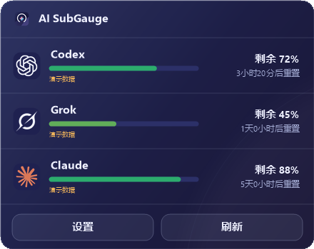
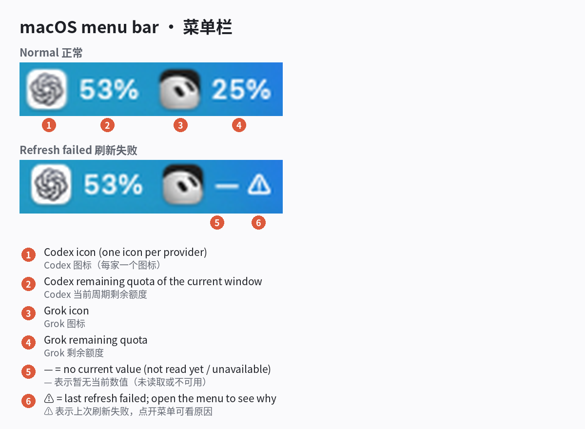
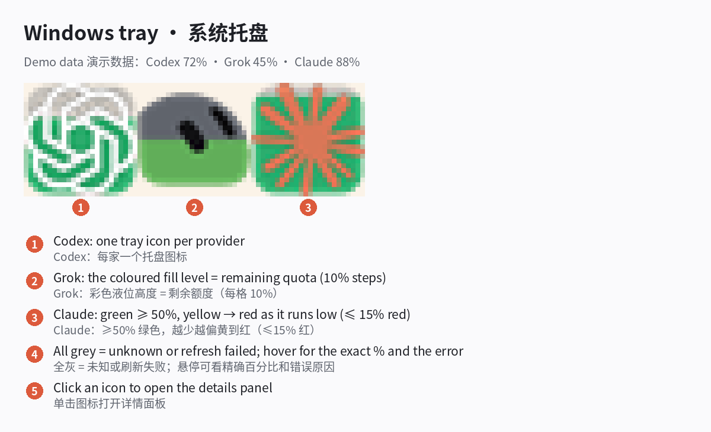
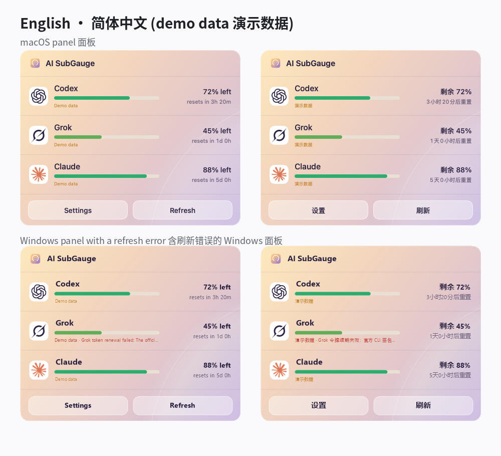

<div align="center">


# AI SubGauge

在 macOS 菜单栏或 Windows 托盘，一眼看到各家 AI 订阅还剩多少额度。

[](mac/README.md)
[](windows/README.md#简体中文)
[](LICENSE)
[](#安装)
[](https://github.com/MK420-max/ai-subgauge/stargazers)

[English](README.md) · **简体中文**

</div>

Mac 2.0 新增额度圆弧菜单栏图标、玻璃面板和统一设置窗口，并提供菜单栏收纳。Windows 保持现有托盘界面。

## 截图

由两版程序的离线预览模式渲染（演示数据：Codex 72%、Grok 45%、Claude 88%）。

| | 白天 | 黑夜 |
|---|---|---|
| **macOS** |  |  |
| **Windows** |  |  |

### 图标含义



macOS 2.0 菜单栏：每家订阅显示服务图标和剩余额度圆弧，百分比可隐藏、放在圆弧上方或图标旁。玻璃面板显示额度详情、重置时间和刷新错误。上方截图为早期界面。



Windows 托盘（演示数据）：每家一个图标，彩色液位高度就是剩余额度（每格 10%），≥50% 为绿色，越少越偏黄到红，≤15% 为红色。图标全灰表示未知或刷新失败；悬停可看精确百分比和错误原因，单击打开详情面板。



中英文面板对比（演示数据），下排为含刷新错误的 Windows 面板。

## 功能

- 🍎 **macOS：** 在菜单栏显示 Codex、Claude、Grok Bot 订阅的剩余额度和重置时间；可另接 API 账户，在服务商支持时显示余额或用量。
- 🧹 **macOS：** 整理菜单栏图标，分为显示、收纳、始终隐藏三个区域；支持搜索、排序、分组和位置备份。
- 🪟 **Windows：** 只显示剩余额度，每家一个液位托盘图标，另有详情面板。
- 👀 只显示正在运行的 AI App / CLI（关闭后约 30 秒再隐藏），也可设为始终显示所选服务商。
- 🔒 复用本机已有的登录；本机登录复用默认关闭，需按服务商分别允许。
- 🌐 中文和英文；白天、黑夜主题，默认跟随系统。

### 支持的服务商

| 服务商 | macOS | Windows |
|---|:---:|:---:|
| Codex（ChatGPT 订阅） | ✅ | ✅ |
| Claude | ✅ | ✅ |
| Grok Bot | ✅ | ✅ |
| Gemini | API 密钥 | ✅ |
| GitHub Copilot | — | ✅ |
| Kimi | API 密钥 | ✅（Kimi Code） |
| GLM / z.ai | — | ✅ |
| OpenAI API、Anthropic API、xAI API | API 密钥 | — |
| DeepSeek API、OpenRouter API、MiniMax API | API 密钥 | — |

各 API 密钥能显示什么取决于服务商，详见 [mac/AI_SUPPORT.md](mac/AI_SUPPORT.md) 和 [Windows 额度来源](windows/README.md#本机登录与额度来源)。

## 安装

macOS 26 可以安装，但尚未在 macOS 26 真机上测试，菜单栏图标的识别可能有差异。

目前还没有预编译的发布包，请先按下文从源码构建，然后：

- **macOS 26 及以上（Apple Silicon）：** 把 `dist/AI SubGauge.app` 移到 `/Applications`。构建使用临时签名、未经公证，Gatekeeper 可能要求手动允许。整理图标需要辅助功能权限。
- **Windows：** 把发布出的文件复制到 `%LOCALAPPDATA%\Programs\AISubGauge\`，运行 `AISubGauge.exe`，不需要管理员权限。

从 Mac AI Bar Cleaner 或 WindowsQuotaTray 升级：首次启动会自动迁移设置，详见 [mac/docs/MIGRATION.md](mac/docs/MIGRATION.md) 和 [windows/README.md](windows/README.md#从-windowsquotatray-迁移)。

## 使用

1. 在你已经在用的官方 App 或 CLI 里登录（Codex、Claude Code、Grok CLI 等）。
2. 允许 AI SubGauge 复用该登录：macOS 在 **设置 → 通用**；Windows 在检测到服务商时按提示允许，或在托盘菜单的 **本机登录授权** 中设置。每家单独开关。
3. 在菜单栏或托盘查看百分比。额度每五分钟刷新一次，也可以点 **刷新**。
4. 选择显示哪些服务商，以及是否只在其运行时显示。

macOS 快捷键：`⇧⌘B` 切换收纳栏，`⇧⌘Space` 搜索图标。

## 从源码构建

macOS（在 `mac/` 下）：

```sh
swift test --sdk "$(xcrun --show-sdk-path)" --triple arm64-apple-macosx26.0
zsh build.sh          # 输出 dist/AI SubGauge.app 和 .zip
```

Windows（在 `windows/` 下，需要 .NET 8 SDK）：

```powershell
dotnet restore .\AISubGauge.sln --locked-mode
dotnet test .\tests\AISubGauge.Tests\AISubGauge.Tests.csproj -c Release
dotnet publish .\src\AISubGauge\AISubGauge.csproj -c Release -r win-x64 --self-contained true -p:PublishSingleFile=true -o .\publish\win-x64
```

`mac/`、`windows/`、`shared/` 需保持同级。完整说明见 [mac/README.md](mac/README.md) 和 [windows/README.md](windows/README.md#简体中文)。

## 隐私与安全

- 令牌只留在本机。程序只读本机已有的登录文件，只发给各家官方接口，不写日志。
- 只读之外有两项例外：Grok 官方 CLI 续期会回写它自己的 `auth.json`，之后程序会收紧该文件的权限；macOS 上你添加的 API 密钥保存在钥匙串里。
- 检测运行中的 AI 只读进程名，不读命令行、路径或进程内存。
- 不发送任何模型提示词，不读浏览器 Cookie。
- 其他用户可读的凭据文件一律拒绝；CLI 必须先通过官方代码签名校验才会运行。
- 导出诊断前先显示脱敏预览。

详见 [macOS SECURITY.md](mac/docs/SECURITY.md)、[Windows SECURITY.md](windows/docs/SECURITY.md)、[macOS PRIVACY.md](mac/PRIVACY.md)。

## 常见问题

**菜单栏显示 `—` 或 `⚠︎`。** 暂无当前数值，或上次刷新失败。点开菜单看原因，例如登录过期，需要在官方 App 里重新登录。

**某家没有显示。** 默认只显示正在运行的 AI App / CLI。可打开"始终显示已勾选的 AI"，并确认已允许该服务商复用本机登录。

**Windows 显示"演示数据"。** 真实读取失败了，原因写在面板和悬停提示里。

**会消耗我的额度吗？** 不会。程序只读用量接口，从不发送提示词。

## 参与贡献

欢迎提 Issue 和 Pull Request。提交前请跑通上面的 macOS 和 Windows 测试，界面文字请同时更新 `shared/i18n/en.json` 和 `shared/i18n/zh-Hans.json`。

## 许可证

[MIT](LICENSE)。各家名称和 logo 归其所有者，详见 [mac/THIRD_PARTY_NOTICES.md](mac/THIRD_PARTY_NOTICES.md) 和 Windows README。

## Star 趋势

如果 AI SubGauge 对你有帮助，点个 ⭐ 能让更多人看到它，谢谢！

[](https://star-history.com/#MK420-max/ai-subgauge&Date)
