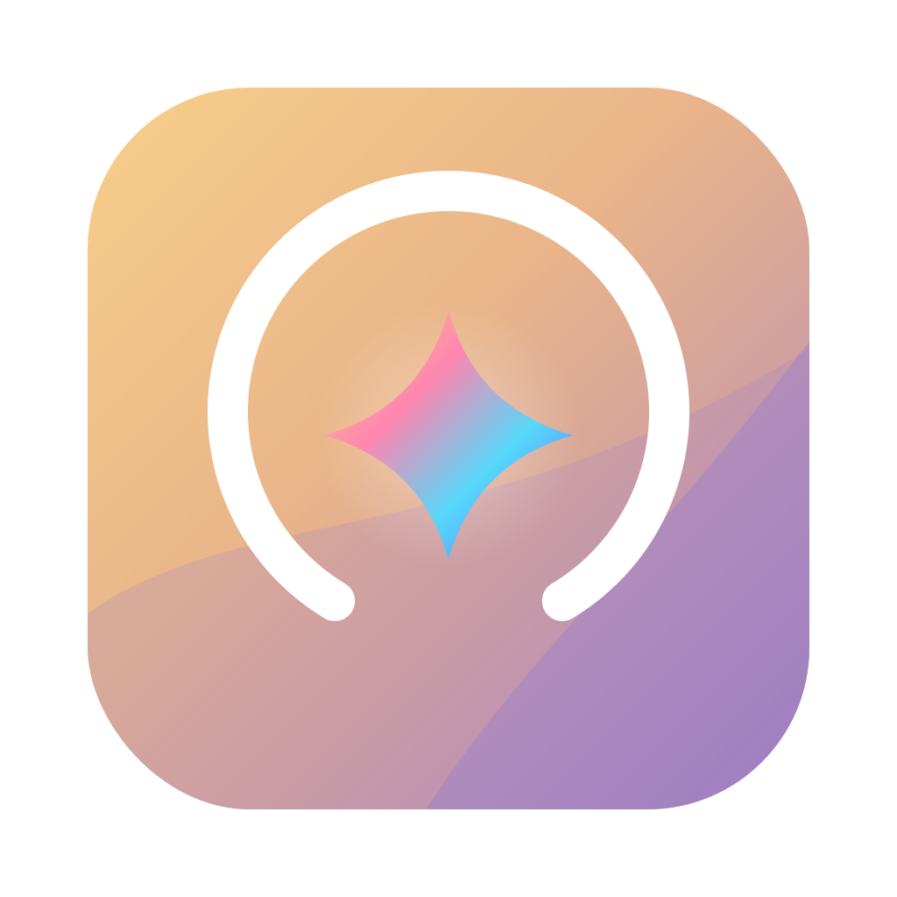

# AI SubGauge

AI SubGauge 2.0.3 for Mac shows the remaining allowance of popular AI subscriptions, with menu bar icon organization built in. It is written in Swift, SwiftUI and AppKit; the interface supports English and Simplified Chinese.

## Features

Mac 2.0 adds per-subscription quota arcs in the menu bar, glass panels, and one settings window for subscriptions and menu bar collection. Percentages can be hidden or placed above the arc or beside the icon; subscriptions can be reordered and individually hidden from the menu bar.

- View Codex, Grok Bot and Claude subscription allowances, with reset times and clear error states.
- Show only running AI providers, with provider checkboxes, a 30-second grace period and an idle menu bar entry.
- Follow the system language or select English / Simplified Chinese.
- Connect selected API services separately from subscriptions. See [AI_SUPPORT.md](AI_SUPPORT.md) for availability and limits.
- Organize menu bar icons into visible, collected and always-hidden zones; search, reorder, group and back up positions.
- Use layout presets, shortcuts, optional automation, appearance settings and widgets.

Default shortcuts: `⇧⌘B` toggles the collection bar; `⇧⌘Space` searches icons.

## Running providers and visibility

In **Settings → Subscriptions → Account details**, choose **Show providers** and **Always show all selected providers**. The same controls are available by right-clicking the AI usage status item. With no explicit checkbox override, connected, previously updated or locally configured accounts remain selected automatically. Each checkbox overrides that account's automatic selection; **Use connected-account defaults** clears these overrides.

`AlwaysShowAll` is stored in UserDefaults and defaults to `false`. Final visibility is selected providers intersected with providers detected as running or within the grace period. Always Show bypasses that running filter while preserving checkboxes. A provider appears at the next 5-second poll; after its first absent sample, it stays visible for 30 seconds. Reappearance at any poll makes it visible immediately. When none are visible, a monochrome template idle status item shows no quota. Click it for provider selection, Always Show, Settings, diagnostics and Quit. Launch at login remains in Settings → General. The existing “Show remaining quota in the menu bar” preference still controls the AI status item; the main app status item remains available for settings.

The shared flat object [`../shared/running-processes.json`](../shared/running-processes.json) maps provider IDs to arrays of process names. Matching is exact and case-insensitive. Default groups are `codex`, `grok`, `claude`, `gemini`, `copilot`, `kimi`, `glm`. Mac uses only its existing providers: subscription providers use their own IDs; API accounts map OpenAI → `codex`, Anthropic → `claude`, Gemini → `gemini`, xAI → `grok`, Kimi → `kimi`. DeepSeek, OpenRouter and MiniMax use `deepseek`, `openrouter`, `minimax`; add these groups in a custom map if needed, or enable Always Show. Copilot and GLM do not create new Mac providers.

To override the whole map, place a valid same-format `running-processes.json` in `~/Library/Application Support/com.mike.aisubgauge/`, then restart. An empty provider array matches nothing. An invalid override falls back to the bundled map. The app reads only `NSWorkspace.runningApplications` localized names / executable filenames and process names from `proc_listallpids` + `proc_name`. It never reads command lines, arguments or process memory for detection. Names are matched locally and are not included in diagnostics. `build.sh` copies the canonical shared map into the app's Resources.

## Language and shared text

**Settings → General → Language** offers Follow system, English and 简体中文. Default system selection uses Simplified Chinese for `zh*`, English otherwise. The `Language` UserDefaults value is `system`, `en` or `zh-Hans`; changing it takes effect after restarting the app. `--lang en|zh-Hans` overrides the language for a development preview without saving a preference.

All app-authored UI text is keyed in [`../shared/i18n/en.json`](../shared/i18n/en.json) and [`zh-Hans.json`](../shared/i18n/zh-Hans.json). Both platforms can reuse the same flat keys and numbered placeholders (`{0}`, `{1}`). `build.sh` copies both catalogs to `Resources/i18n`; SwiftPM development runs from this directory load the shared files directly. Provider names and unknown values are also catalog entries. Native bundle names and permission descriptions are generated from these catalogs by `Resources/localize-info.py`. System permission dialogs follow macOS; server-returned account names, plans and errors retain their original content. Durable internal identifiers and existing storage filenames stay stable across languages.

Validate catalog key equality, nonempty values, matching placeholders and referenced source keys:

```sh
python3 ../shared/i18n/check-keys.py
# Optional source directories can be passed for other platforms.
```

## App logo and themes

**Settings → General → Theme** offers Follow system, Light and Dark. The `Theme` UserDefaults value is `system`, `light` or `dark`; an absent or unrecognized value follows macOS `effectiveAppearance`. Changes apply immediately to the panel, settings, account sheets and native prompts. The compact panel has one row per visible provider, remaining-quota arcs, reset countdowns and equal-width Settings / Refresh buttons. Demo and error messages remain in each row's subtitle.

Colors come from [`../shared/theme.json`](../shared/theme.json), copied into the development app at packaging. Both palettes share the same keys. `#RRGGBB` and `#RRGGBBAA` are supported. Quota colors use green/yellow/red and continuous transitions: red through 15%, yellow at 32.5%, green from 50%. Provider glyphs are monochrome template SVGs with public-license provenance in the shared assets directory.

The bundle's `CFBundleIconFile` is `AISubGauge-light.icns`. Both icon variants are packaged; `NSApp.applicationIconImage` switches with the effective app appearance. Finder retains the static light bundle icon. The idle menu bar image uses the monochrome `tray-mono` artwork at 1×/2× with `isTemplate = true`, allowing macOS to tint it for the menu bar.

## Requirements and installation

The app can be installed on macOS 26, but it has not yet been tested on a physical Mac running macOS 26; menu bar icon detection may differ.

macOS 26.0 or later. The package uses Swift tools 5.9, Swift 5 language mode and Swift Testing. Packaging is intended for Apple Silicon.

Build the app, then move it to `/Applications/AI SubGauge.app` yourself. Builds use ad hoc signing; they are not Developer ID signed or notarized, so Gatekeeper may require approval. Accessibility permission is needed for icon organization. Menu bar position access, Calendar, Music automation and Wi-Fi location access are requested only for the relevant optional features. The menu bar bridge uses private macOS APIs and may need updates after system changes.

In **Settings → General → Launch at login** (设置 → 通用 → 登录时启动), the existing switch uses `SMAppService.mainApp.register()` / `unregister()`. Its state reflects the system registration status; when approval is required, use the button to open Login Items settings. Login registration belongs to the installed app and is not enabled automatically by migration. This development pass does not register a login item or change an installed app.

## Upgrading from the old name

AI SubGauge replaces the former Mac AI Bar Cleaner / mac-menu-bar-tidy name. At the first normal launch, it copies preferences, Application Support files and this app's API Keychain items to the new identifiers. Existing new data wins; old data is retained. Failed stages retry on a later launch. See [docs/MIGRATION.md](docs/MIGRATION.md) for identifiers, compatibility and rollback details.

The new bundle ID is `com.mike.aisubgauge`; the bundled executable and SwiftPM product are `AISubGauge`. The source module remains `TidyBar`. macOS may ask for permissions again because the app identity changed. Quit the old app before opening the new one; remove an old login item manually if it is still registered.

## Account access and privacy

Local login reuse is **off by default**. Settings → General has separate consent switches for Codex / ChatGPT, Claude Code and Grok CLI / Grok Bot. Enabling one never enables another. Claude can also use an independent, explicitly connected official web session. API keys entered in Add Account are stored in the system Keychain only after validation.

Credential files, including Claude `.credentials.json`, Grok `auth.json` and Codex `auth.json`, must be owned by the current user and must not be readable by the group or others. Shared modes such as `0644` are refused with a localized instruction to set permissions to 600. Symlinks, unsafe ownership, writable shared files and oversized files are rejected. Private app directories use `0700`, and app-written private files use `0600`.

Codex requires an officially signed Mach-O app or CLI; npm `codex.js` launchers are not supported. The executable is opened and copied into a private `0700` directory. The copy must pass OpenAI Developer ID signature validation (team `2DC432GLL2`) before it is executed. After a read completes, fails, times out or is cancelled, the app sends `SIGTERM` and then `SIGKILL` to the isolated process group and reaps the main process.

Grok keeps the official CLI login and same-account ACP token renewal flow. If a CLI download is necessary, only the official `https://x.ai/cli/` host is accepted. Before a download is installed or any CLI is run, `codesign --verify --strict -R` must validate the Apple Developer ID chain, the pinned xAI team `5Y6N3AJ54S` and executable identifier `xai-grok-pager`; failure stops execution. Cached and installed binaries receive the same check, with restricted installation paths and ownership/permission checks. A certificate/team/identifier change requires a reviewed app update. No unverified fallback is executed. Renewal errors appear on the provider card; tokens and CLI output are not logged. After the Grok renewal process group exits, credentials are opened with `O_NOFOLLOW`, checked to be a regular file owned by the current user, and restricted to `0600` with `fchmod`. This cleanup also runs on failure, timeout and cancellation. See [AI_SUPPORT.md](AI_SUPPORT.md).

**Settings → General → Export diagnostics…** first opens a redacted preview. Only after confirmation can the displayed text be copied or saved. The report contains the app/version, OS version and fixed provider states; it excludes credentials, raw server errors, emails and account data. Paths, hostnames and common secret formats are also redacted. The `--diagnostics` option and existing automation URL open the same preview.

Usage checks do not send model prompts. Weather requests send the configured city coordinates to Open-Meteo. See [PRIVACY.md](PRIVACY.md) and [THIRD_PARTY_NOTICES.md](THIRD_PARTY_NOTICES.md).

## Build, test and package

Run every test from this directory:

```sh
swift build --sdk "$(xcrun --show-sdk-path)" --triple arm64-apple-macosx26.0
swift test --sdk "$(xcrun --show-sdk-path)" --triple arm64-apple-macosx26.0
# Alternatively, test.sh forwards all arguments:
zsh test.sh --sdk "$(xcrun --show-sdk-path)" --triple arm64-apple-macosx26.0
```

The SDK is selected from the active developer tools; the target triple sets the minimum OS to macOS 26.0. There are no external Swift package dependencies. The Objective-C bridge retains ARC for callback and object lifetimes.

```sh
zsh build.sh
zsh package-dmg.sh
```

Outputs: `dist/AI SubGauge.app`, `dist/AI SubGauge.zip`, and `dist/AI SubGauge-2.0.3-arm64.dmg`. Intermediate files remain in `.build/`. Packaging does not install or open the app. Additional Swift build options can be passed to `build.sh`; an existing DMG is never overwritten.

In a restricted development sandbox, keep caches and temporary files in this checkout, and use a fresh module cache if this checkout was copied from another path:

```sh
mkdir -p .build/unify-module-cache .build/unify-tmp
export CLANG_MODULE_CACHE_PATH="$PWD/.build/unify-module-cache"
export SWIFTPM_MODULECACHE_OVERRIDE="$PWD/.build/unify-module-cache"
export TMPDIR="$PWD/.build/unify-tmp"
swift build --sdk "$(xcrun --show-sdk-path)" --triple arm64-apple-macosx26.0 --disable-sandbox --disable-keychain --disable-netrc --cache-path .build/unify-cache --config-path .build/config --security-path .build/security
swift test --sdk "$(xcrun --show-sdk-path)" --triple arm64-apple-macosx26.0 --disable-sandbox --disable-keychain --disable-netrc --cache-path .build/unify-cache --config-path .build/config --security-path .build/security
```

## Offline development preview

```sh
for theme in light dark; do
  for lang in en zh-Hans; do
    .build/debug/AISubGauge --render-preview .build/preview/theme --theme "$theme" --lang "$lang"
  done
done
# Build first, then render a selected combination:
zsh render-preview.sh .build/preview/theme --theme dark --lang zh-Hans
```

This mode uses SwiftUI `ImageRenderer` and fixed offline demo data: Codex 72%, Grok 45%, Claude 88%. Each command writes `mac-panel-{light|dark}-{en|zh-Hans}.png` in the requested directory and a matching Retina image under `2x/`. Four theme/language combinations produce eight PNGs (440 × 350 and 880 × 700). It never starts migration, account readers, process polling or network refreshes, and never saves theme/language preferences. An available macOS graphics session is required. These previews do not establish installed-app or real-account acceptance.

## License

MIT; the original author notice is preserved in LICENSE. Third-party notices and offline logo licenses ship in the app bundle.

Public builds use the Lobe Icons Grok logo by default and exclude private artwork even when it exists locally. For a local private build, provide `shared/private-logos/grokbot.png` and run `AISUBGAUGE_PRIVATE_LOGOS=1 zsh build.sh` from `mac/`. The private logo is copied only when the flag is explicitly set to `1` and the file exists.

If AI SubGauge is useful to you, a ⭐ on GitHub would be much appreciated.

---

# AI SubGauge（简体中文）

AI SubGauge 2.0.3 Mac 版用于查看常用 AI 订阅的剩余额度，并提供菜单栏图标收纳功能。应用使用 Swift、SwiftUI 和 AppKit 开发，界面支持英文和简体中文。

## 功能

Mac 2.0 提供逐家订阅的菜单栏额度圆弧、玻璃面板，以及集中管理订阅和菜单栏收纳的统一设置窗口。百分比可隐藏、显示在圆弧上方或图标旁；订阅可拖动排序并单独控制菜单栏显示。

- 查看 Codex、Grok Bot 和 Claude 订阅额度、重置时间及错误状态。
- 只显示正在运行的 AI，支持厂商勾选、30 秒宽限和空闲菜单栏入口。
- 跟随系统语言，或手动选择 English / 简体中文。
- 单独连接部分 API 服务；订阅与 API 额度分开显示。支持范围见 [AI_SUPPORT.md](AI_SUPPORT.md)。
- 将菜单栏图标分为始终显示、收纳、始终隐藏，支持搜索、排序、分组和位置备份。
- 使用布局预设、快捷键、可选自动规则、外观设置及小组件。

默认快捷键：`⇧⌘B` 展开或收起收纳条；`⇧⌘Space` 搜索图标。

## 运行状态与显示范围

在 **设置 → 订阅 → 账户详情** 中选择 **显示哪几家** 和 **始终显示已勾选的 AI**；右键 AI 用量状态项也能切换。没有手动勾选记录时，沿用自动规则：已连接、曾更新或本机已配置的账户默认选中。各家勾选会覆盖该账户的自动选择；**恢复自动显示已连接账户** 会清除这些手动记录。

`AlwaysShowAll` 保存在 UserDefaults，默认 `false`。最终可见集合为：已勾选的账户 ∩ 正在运行或处于宽限期的账户。“始终显示”跳过运行筛选，仍遵循勾选。检测每 5 秒进行一次；首次检测到进程消失后保留显示 30 秒。任一次轮询重新检测到进程时立即显示。一家都不可见时，保留单色 template 空闲状态项，不显示额度。点击可进入厂商勾选、始终显示、设置、诊断和退出；开机自启仍在“设置 → 通用”。原有“在菜单栏显示剩余额度”开关继续控制 AI 状态项；应用主状态项仍可用于进入设置。

共享文件 [`../shared/running-processes.json`](../shared/running-processes.json) 是扁平对象：每个厂商 ID 对应一组进程名。采用不区分大小写的完整名称匹配。默认分组为 `codex`、`grok`、`claude`、`gemini`、`copilot`、`kimi`、`glm`。Mac 仅对已有 provider 生效：订阅使用自身 ID；API 账户按 OpenAI → `codex`、Anthropic → `claude`、Gemini → `gemini`、xAI → `grok`、Kimi → `kimi` 匹配。DeepSeek、OpenRouter、MiniMax 分别使用 `deepseek`、`openrouter`、`minimax`；需要时在自定义映射中添加，或开启“始终显示”。Copilot 和 GLM 不会新增 Mac provider。

如需覆盖完整映射，在 `~/Library/Application Support/com.mike.aisubgauge/` 放入同格式的 `running-processes.json` 后重启。某家数组为空时不匹配任何进程；覆盖文件无效时回退到打包默认值。检测只读取 `NSWorkspace.runningApplications` 的 localizedName / 可执行文件名，以及 `proc_listallpids` + `proc_name` 返回的进程名，不读取命令行、参数或进程内存。进程名只在本机匹配，不写入诊断。`build.sh` 将共享映射复制到应用 Resources。

## 界面语言与共享文案

**设置 → 通用 → 语言** 提供“跟随系统 / English / 简体中文”。默认跟随系统：`zh*` 使用简体中文，其余使用英文。UserDefaults 的 `Language` 值为 `system`、`en` 或 `zh-Hans`；修改后重启应用生效。开发预览可用 `--lang en|zh-Hans` 临时指定语言，不保存偏好。

应用自身界面文案统一引用 [`../shared/i18n/en.json`](../shared/i18n/en.json) 与 [`zh-Hans.json`](../shared/i18n/zh-Hans.json) 中的扁平键，两端可共用键和编号占位符（`{0}`、`{1}`）。`build.sh` 将文件复制到 `Resources/i18n`；从本目录运行的 SwiftPM 开发版本直接读取 shared 文件。厂商名称和未知值也在语言文件中。`Resources/localize-info.py` 也从共享语言文件生成原生应用名称与权限说明。系统权限弹窗遵循 macOS 语言；服务返回的账户名、套餐和错误保留原文。内部持久化标识和已有存储文件名不随语言变化。

检查两种语言键集合一致、值非空、占位符一致，以及代码引用的键均存在：

```sh
python3 ../shared/i18n/check-keys.py
# 可附加其他平台的源码目录。
```

## App 图标与主题

**设置 → 通用 → 主题** 提供“跟随系统 / 浅色 / 深色”。UserDefaults 的 `Theme` 值为 `system`、`light` 或 `dark`；缺失或无法识别时跟随 macOS 的 `effectiveAppearance`。修改后，面板、设置、账户弹窗和系统原生提示即时生效。紧凑面板每家一行，显示剩余额度圆弧和重置倒计时，底部为等宽“设置 / 刷新”按钮；演示和错误提示保留在行内副文字处。

颜色来自 [`../shared/theme.json`](../shared/theme.json)，打包时复制到开发 App。两套主题的键集合相同，支持 `#RRGGBB` 和 `#RRGGBBAA`。额度圆弧使用连续过渡配色：15% 及以下为红色，32.5% 为黄色，50% 起为绿色。厂商图标使用公开许可的单色 template SVG，来源记录在共享素材目录。

`CFBundleIconFile` 使用 `AISubGauge-light.icns`，同时打包浅深两版；`NSApp.applicationIconImage` 随应用的有效浅深外观切换。Finder 使用静态浅色包图标。空闲菜单栏图标使用 `tray-mono` 单色素材的 1×/2× 版本，设置 `isTemplate = true`，由 macOS 根据菜单栏外观着色。

## 系统要求与安装

macOS 26 可以安装，但尚未在 macOS 26 真机上测试，菜单栏图标的识别可能有差异。

需要 macOS 26.0 或更新版本。项目使用 Swift tools 5.9、Swift 5 语言模式和 Swift Testing；打包面向 Apple 芯片。

构建后由用户自行移入 `/Applications/AI SubGauge.app`。构建使用临时签名，没有 Developer ID 签名或公证，Gatekeeper 可能要求确认。图标收纳需要辅助功能权限；菜单栏位置文件、日历、音乐自动化、Wi-Fi 定位权限仅在使用对应可选功能时请求。菜单栏桥接使用 macOS 私有 API，系统更新后可能需要适配。

**设置 → 通用 → 登录时启动** 使用 `SMAppService.mainApp.register()` / `unregister()`，开关反映系统实际注册状态。需要批准时可打开系统登录项设置。登录项属于已安装的应用，迁移不会自动启用。本轮开发不注册登录项，也不修改已安装应用。

## 从旧名称升级

AI SubGauge 接替 Mac AI Bar Cleaner / mac-menu-bar-tidy。首次正常启动时，将偏好、Application Support 文件及本应用 API 钥匙串条目复制到新标识下。已有新数据优先，旧数据保留；失败阶段在后续启动时重试。标识、兼容和回退说明见 [docs/MIGRATION.md](docs/MIGRATION.md)。

新 bundle ID 为 `com.mike.aisubgauge`，可执行文件及 SwiftPM product 为 `AISubGauge`，源码模块仍为 `TidyBar`。应用标识变化后 macOS 可能重新要求授权。打开新应用前请退出旧应用；旧登录项若仍注册，需手动移除。

## 账户访问与隐私

本机登录复用 **默认关闭**。设置 → 通用分别提供 Codex / ChatGPT、Claude Code、Grok CLI / Grok Bot 的同意开关，开启一家不会开启另一家。Claude 也可显式连接独立的官方网页会话。添加账户中输入的 API 密钥仅在验证通过后保存到系统钥匙串。

凭据文件包括 Claude `.credentials.json`、Grok `auth.json` 和 Codex `auth.json`，必须属于当前用户，且不能被组或其他人读取。`0644` 等共享权限会被拒绝，并提示改为 `600`。符号链接、不安全的所有者、可被他人写入或过大的文件也会被拒绝。应用私有目录使用 `0700`，应用写入的私有文件使用 `0600`。

Codex 仅接受官方签名的 Mach-O App／CLI，不支持 npm 的 `codex.js` 启动脚本。程序先打开可执行文件，复制到 `0700` 私有目录，验证副本的 OpenAI Developer ID 签名（团队 `2DC432GLL2`），再执行该副本。读取结束、超时、报错或取消后，向独立进程组发送 `SIGTERM`，再发送 `SIGKILL` 并回收主进程。

Grok 保留官方 CLI 登录和同账户 ACP 令牌续期流程。需要下载 CLI 时，仅接受官方 `https://x.ai/cli/` 主机。下载内容安装前及任何 CLI 执行前，必须通过 `codesign --verify --strict -R` 检查 Apple Developer ID 签名链、固定 xAI 团队 `5Y6N3AJ54S` 和可执行文件标识 `xai-grok-pager`，失败即停止。缓存与已安装二进制采用同样检查，并限制安装路径、所有者和权限。证书、团队或标识变更需要审核后的应用更新，不执行未验证的后备程序。续期错误显示在账户卡片上，不记录令牌或 CLI 输出。Grok 续期进程组退出后，无论成功、报错、超时或取消，都会以 `O_NOFOLLOW` 打开凭据文件，核对普通文件与当前用户所有者，并用 `fchmod` 收紧为 `0600`。详见 [AI_SUPPORT.md](AI_SUPPORT.md)。

**设置 → 通用 → 导出诊断…** 先打开脱敏预览，确认后才可复制或保存。诊断仅包含应用名称、版本、系统版本及固定服务状态，不含凭据、原始服务错误、邮箱和账户数据；路径、主机名及常见密钥格式也会脱敏。`--diagnostics` 和原有自动化 URL 打开同一预览。

用量检查不发送模型提示词。天气请求会将配置的城市经纬度发送至 Open-Meteo。详见 [PRIVACY.md](PRIVACY.md) 与 [THIRD_PARTY_NOTICES.md](THIRD_PARTY_NOTICES.md)。

## 构建、测试与打包

在本目录执行全部测试：

```sh
swift build --sdk "$(xcrun --show-sdk-path)" --triple arm64-apple-macosx26.0
swift test --sdk "$(xcrun --show-sdk-path)" --triple arm64-apple-macosx26.0
# test.sh 也可转发参数：
zsh test.sh --sdk "$(xcrun --show-sdk-path)" --triple arm64-apple-macosx26.0
```

SDK 由当前开发工具选择；目标 triple 将最低系统版本设为 macOS 26.0。项目没有外部 Swift package 依赖；Objective-C 桥接保持 ARC 以管理对象及回调生命周期。

```sh
zsh build.sh
zsh package-dmg.sh
```

产物为 `dist/AI SubGauge.app`、`dist/AI SubGauge.zip` 和 `dist/AI SubGauge-2.0.3-arm64.dmg`，中间文件留在 `.build/`。打包不会安装或打开应用。`build.sh` 可接收额外 Swift 构建参数；已有 DMG 不会被覆盖。

在受限沙箱中，将缓存及临时文件保留在本项目；如果项目从其他路径复制而来，使用新的模块缓存：

```sh
mkdir -p .build/unify-module-cache .build/unify-tmp
export CLANG_MODULE_CACHE_PATH="$PWD/.build/unify-module-cache"
export SWIFTPM_MODULECACHE_OVERRIDE="$PWD/.build/unify-module-cache"
export TMPDIR="$PWD/.build/unify-tmp"
swift build --sdk "$(xcrun --show-sdk-path)" --triple arm64-apple-macosx26.0 --disable-sandbox --disable-keychain --disable-netrc --cache-path .build/unify-cache --config-path .build/config --security-path .build/security
swift test --sdk "$(xcrun --show-sdk-path)" --triple arm64-apple-macosx26.0 --disable-sandbox --disable-keychain --disable-netrc --cache-path .build/unify-cache --config-path .build/config --security-path .build/security
```

## 离线开发预览

```sh
for theme in light dark; do
  for lang in en zh-Hans; do
    .build/debug/AISubGauge --render-preview .build/preview/theme --theme "$theme" --lang "$lang"
  done
done
# 先构建，再输出指定组合：
zsh render-preview.sh .build/preview/theme --theme dark --lang zh-Hans
```

此模式使用 SwiftUI `ImageRenderer` 和固定离线演示数据：Codex 72%、Grok 45%、Claude 88%。每次在指定目录写入 `mac-panel-{light|dark}-{en|zh-Hans}.png`，并在 `2x/` 中写入同名高清图。四组主题和语言组合共输出八张 PNG（440 × 350 和 880 × 700），不启动迁移、账户读取、进程轮询或网络刷新，也不保存主题和语言偏好。需要可用的 macOS 图形会话；预览不代表已安装应用或真实账户验收。

## 许可证

MIT；原作者版权声明保留于 LICENSE。第三方声明与离线图标许可证随应用打包。

公开构建默认使用 Lobe Icons 的 Grok 图标，即使本地存在私有素材也不会打包。仅供本地私用的构建：将素材放在 `shared/private-logos/grokbot.png`，从 `mac/` 运行 `AISUBGAUGE_PRIVATE_LOGOS=1 zsh build.sh`。只有显式设置为 `1` 且文件存在时才复制私有图标。

如果 AI SubGauge 对你有帮助，欢迎在 GitHub 点一颗 ⭐。
